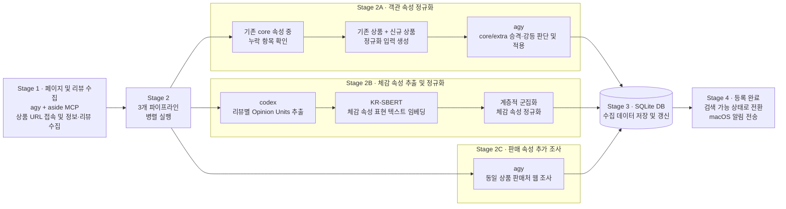

# 리뷰의 사용 경험을 검색 가능한 카탈로그로

본 프로젝트 취미로 시작한 여러 홈페이지에 흩어져있는 키보드의 정보와 리뷰를 수집하던 작은 자동화 도구에서 범용적인 상품들의 체감 속성을 비교하는 MCP를 거쳐, 최종적으로는 객관, 체감, 판매 속성을 종합적으로 고려하여 상품을 검색 및 추천하는 AI 쇼핑 에이전트로 발전시켜 나아가는 전 과정을 포함하고 있습니다.

## 개요

저는 키보드를 12대나 가지고 있을 만큼 키보드에 관심이 많습니다. 같은 키압이라도 사람마다 느끼는 타건감이 달라 제품 비교 시 실사용자의 리뷰가 중요하기에 여러 사이트에 흩어진 리뷰를 수집하여 체감 정보를 비교·분석하는 과정을 자동화한 MCP를 만들어 사용해 왔습니다.

이후 지인들과 이 MCP를 공유하며 다루는 상품군이 다양해지고 리뷰 양이 급증하자 일관된 비교와 집계가 어려워지는 문제를 발견했습니다. 예를 들어 '키감이 묵직하다'와 '타건감이 무겁다'처럼 같은 체감 속성도 사람과 상품군에 따라 제각각으로 표현되었기 때문입니다. 이에 여러 상품군에 일관되게 적용될 범용 구조를 설계하고자 비정형 문장에서 속성을 규격화해 비교를 가능하게 하는 속성 추출 표준화와, 파편화된 유사 어휘를 하나로 묶어 집계 유효성을 높이는 표현 정규화를 해결 과제로 삼았습니다. 이후 선행 연구와 구축 사례를 조사하여 리뷰를 속성, 상태, 의견, 감성 단위로 구조화하는 Opinion Units와 KR-SBERT 임베딩 기반 계층적 군집화를 각 과제의 구체적인 구현 방안으로 도출했습니다.

구현에 앞서 약 500MB 규모의 임베딩 모델이 유발하는 연산 부담 대비 실효성을 검증하기 위해 두 기법의 적용 유무를 독립 변수로 둔 2x2 실험을 설계했습니다. 3명이 참여한 300회의 비교 평가 결과, 추출 표준화 방식이 98%의 선호도를 얻었으며 표현 정규화는 파편화된 속성을 약 53% 압축하면서도 군집 대표성·응집도 평가에서 4.7/5점을 기록해 두 방법의 유효성을 입증했습니다. 이 결과를 근거로 수집 파이프라인에 두 기법을 적용하여 상품군에 구애받지 않고 주관적 경험을 일관된 기준으로 비교하는 범용 쇼핑 MCP를 최종 배포하고 이를 운영 가능한 카탈로그 시스템으로 확장하여 포트폴리오로서 구성하였습니다.

돌이켜보면 키보드에 머물던 작은 도구가 추출과 정규화 알고리즘을 통해 어떤 상품군의 제각각인 리뷰도 스스로 구조화하고 묶어내는 단단한 시스템으로 발전해 가는 과정이 즐거워 깊이 몰입했습니다. 무엇보다 이 프로젝트를 끝까지 완수하며, 단기적인 기능 구현에 그치지 않고 초기 설계부터 재사용할 수 있는 구조를 구상해 AI로 빠르게 실험하고 검증하는 습관이 자리잡게된 의미있는 프로젝트입니다. 이에 따라 설계 과정에서의 고민과 시행착오, 그리고 기술적 의사결정의 근거를 구체적인 코드와 문서로 남기고자 본 레포지토리와 데모 페이지를 구성했습니다.

백문불여일견, 문서에 앞서 데모를 먼저 체험해 보시는 것을 추천드립니다. [리뷰 보고서 탭](https://subjective-experience-shopping-platform.github.io/review-catalog-platform-demo/#report)에서는 비정형 자연어 리뷰로부터 핵심 정보가 어떻게 추출되고 구조화되는지 직접 확인할 수 있으며, [쇼핑 Agent 탭](https://subjective-experience-shopping-platform.github.io/review-catalog-platform-demo/#chat)에서는 이렇게 정제된 데이터를 기반으로 동작하는 AI 쇼핑 에이전트를 경험해 보실 수 있습니다. 데모를 통해 전체적인 동작 방식을 먼저 파악하신 뒤 각 레포지토리의 상세 문서를 살펴보시면, 코드 이면에 담긴 아키텍처 설계 의도와 기술적 고민을 한층 더 입체적으로 확인하실 수 있습니다.

## 프로젝트 구성

본 프로젝트는 아래 5단계로 진행되었습니다. 각 단계에 대한 구체적인 작업 내용은 각 페이지의 README에서 확인하실 수 있습니다. 

### 1. keyboard-search-mcp

여러 홈페이지에 흩어진 키보드 상품의 스펙과 리뷰를  사용자가 정의한 속성을 LLM을 통해 명시적으로 수집한 뒤, 비교 분석하는 간단한 MCP입니다.

### 2. [semantic-review-extraction-experiment](https://github.com/subjective-experience-shopping-platform/semantic-review-extraction-experiment)

|  |  |
| ------------------------------------------------------------------------------------------------------------------------------------------------------------------------------------------------------------ | ------------------------------------------------------------------------------------------------------------------------------------------------------------------------------------------------------------ |

>이미지 클릭 시 확대됩니다.

다양한 상품과 리뷰에서 비교 가능한 속성 구조를 정의하기 위해, '속성 추출 형식 표준화(구조화)'와 '속성 표현 정규화(유사 의미 통합)'를 핵심 과제로 설정하고 2x2 실험을 진행했습니다. 평가자 3명이 참여한 300회의 비교 평가 결과, 추출 표준화 방식은 98%의 선호도를 기록했습니다. 또한 표현 정규화는 파편화된 속성을 약 53% 압축하면서도 군집 대표성·응집도 평가에서 5점 만점에 4.7점을 달성하여 두 가설의 유효성을 입증했습니다.

### 3. [meta-search](https://github.com/subjective-experience-shopping-platform/meta-search)

semantic-review-extraction 실험으로 도출한 체감 속성 정규화 기법을 수집 파이프라인(위 도표)에 적용해 범용 쇼핑 MCP를 구현 및 배포했습니다. 이를 통해 상품군에 상관없이 주관적인 사용 경험을 일관된 기준으로 비교할 수 있으며, 아래 예시처럼 고객의 연속적인 질문 맥락에 맞춰 검색과 필터링을 수행할 수 있습니다.

1. "가벼운 모니터 추천해 줘"
	- → `[체감속성: 무게>가벼움]` 으로 검색.
2. "지금 이 상품보다 화면이 쨍한 모니터 추천해 줘"
	- → 이전 조건 + `[객관속성: 화면 nit 값]`으로 필터링 후, `[체감속성: 밝기>밝음]` 으로 재검색.
3. "가성비가 별로인 것 같아. 근데 내일까지는 모니터가 필요한데..." 
	- → 이전 조건 + `[판매속성: 배송일(내일)]`으로 필터링 후, `[체감속성: 가성비>좋음]` 으로 재검색.

### 4. [review-catalog-platform](https://github.com/subjective-experience-shopping-platform/review-catalog-platform)

meta-search mcp를 운영 가능한 상품 카탈로그 플랫폼으로 확장했습니다. 이에 따라 다음과 같은 운영적 요소들이 추가되었습니다.

- React와 FastAPI를 통해 전체 시스템을 구성하였으며 Airflow를 통해 데이터 처리 및 카탈로그를 관리합니다.
- 사용자 요청 및 결과 조회와 같은 운영 영역은 FastAPI가, 데이터 처리 및 카탈로그 관리 영역은 Airflow가 담당하도록 책임을 분리하였습니다.
- 운영 정보와 Airflow Metadata는 PostgreSQL에 저장하고, 리뷰 및 카탈로그 데이터는 DuckDB에 저장합니다.
- Docker Compose로 로컬에서 실행하며 GitHub Actions로 테스트·빌드와 배포 계약을 검증합니다. AWS 배포 코드는 보존하지만 새 조직에서는 AWS에 연결하지 않습니다. 수동 배포 입력과 활성화 변수, 배포 설정이 모두 준비된 경우에만 CD를 실행할 수 있습니다.

### 5. [review-catalog-platform-demo](https://github.com/subjective-experience-shopping-platform/review-catalog-platform-demo)

[속성기반 감정분석 데이터셋](https://aihub.or.kr/aihubdata/data/view.do?dataSetSn=71603)에서 추출한 9개의 모니터를 대상으로 `review-catalog-platform`과 `meta-search mcp`의 데모를 제공하는 레포지토리입니다. 

## 라이선스

본 프로젝트의 모든 레포지토리들은 [GNU GPL 3.0](https://github.com/subjective-experience-shopping-platform/.github/blob/main/LICENSE)을 따릅니다. 단, 외부 데이터셋과 모델은 각 제공처의 이용 조건을 따릅니다.
